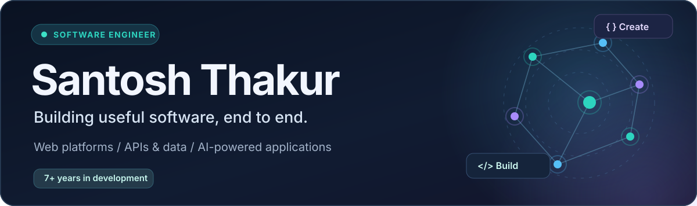
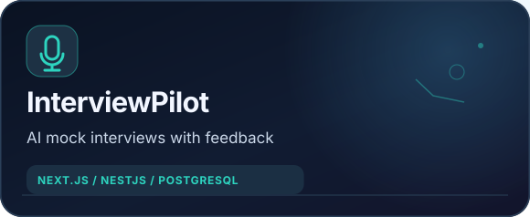
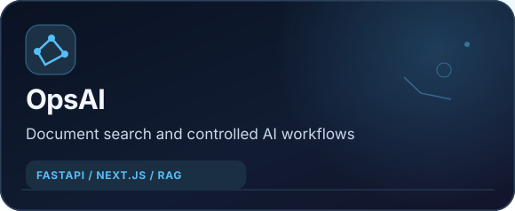
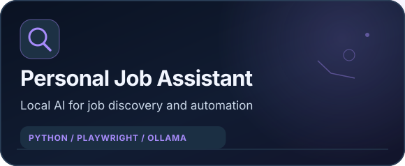
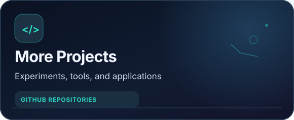
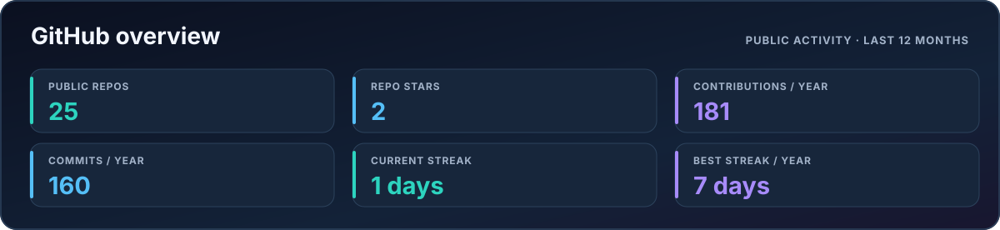
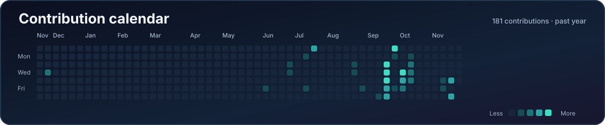
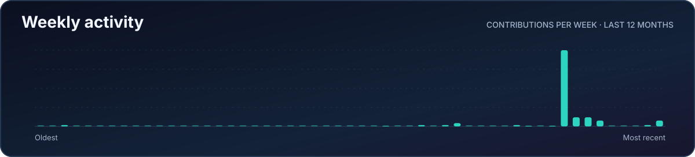
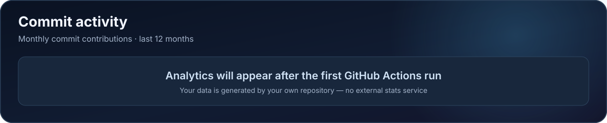

 

**Software Engineer · Full-Stack Development · AI Engineering**

I build software across the stack — from interfaces and APIs to databases, automation, and AI-powered features. With **7+ years in software development**, I care about writing useful code, making systems work well together, and getting better at what I do every day.

 

[**Portfolio**](https://portfolio-st-eta.vercel.app/) &nbsp;·&nbsp; [**LinkedIn**](https://www.linkedin.com/in/ithakurr/) &nbsp;·&nbsp; [**Email**](mailto:santoshthakurxd@gmail.com) &nbsp;·&nbsp; [**Repositories**](https://github.com/SantoshThkr?tab=repositories)

---

### A little about me

- 💻 I work on frontend experiences, backend services, APIs, databases, and the connections between them.
- 🤖 I build with LLMs, retrieval, and automation when they make a product genuinely more useful.
- 🛠️ I enjoy turning ideas into working applications and refining them as I go.
- 📚 I keep learning every day. There's always a better way to solve a problem or something new worth trying.
- 🤝 I'm happy to connect with developers who like building practical things and sharing what they know.

### Featured projects

A few projects that show the kinds of things I enjoy working on.

<table>
  <tr>
    <td width="50%" valign="top">
      
        
      AI mock interviews with follow-up questions, coding rounds, and structured feedback.
        
      <a href="https://github.com/SantoshThkr/InterviewPilot"><strong>View repository →</strong></a>
    </td>
    <td width="50%" valign="top">
      
        
      A full-stack AI operations platform with document search, read-only metrics, and approval-based workflows.
        
      <a href="https://github.com/SantoshThkr/ops-ai"><strong>View repository →</strong></a>
    </td>
  </tr>
  <tr>
    <td width="50%" valign="top">
      
        
      A local job-search assistant that combines browser automation, job matching, and AI-assisted decisions.
        
      <a href="https://github.com/SantoshThkr/Job-Automation"><strong>View repository →</strong></a>
    </td>
    <td width="50%" valign="top">
      
        
      Web applications, developer tools, coding experiments, and other things I've built.
        
      <a href="https://github.com/SantoshThkr?tab=repositories"><strong>Explore all repositories →</strong></a>
    </td>
  </tr>
</table>

### Technologies I work with

| Area | Technologies |
| :-- | :-- |
| **Languages** | JavaScript · TypeScript · Python · SQL |
| **Frontend** | React · Next.js · Angular · Redux Toolkit · RxJS · Tailwind CSS · HTML · CSS |
| **Backend & APIs** | Node.js · Express.js · FastAPI · Flask · REST APIs · GraphQL · WebSockets |
| **Databases & data** | PostgreSQL · MongoDB · Redis · SQLAlchemy · Prisma |
| **AI & automation** | OpenAI APIs · LangChain · RAG · AI agents · Ollama · Vector search · Playwright |
| **Cloud & delivery** | AWS · Docker · GitHub Actions · CI/CD · Git |
| **Testing & quality** | Jest · React Testing Library · Cypress · Playwright · Postman |

### GitHub analytics

  

### Contribution activity

  
  

### Commit activity

  
  Charts update through GitHub Actions. Activity covers the recent 12 months, follows GitHub's contribution rules, and depends on account visibility settings.

---

**Good software is built one improvement at a time.**

Thanks for visiting. Feel free to explore a project or [get in touch](mailto:santoshthakurxd@gmail.com).

